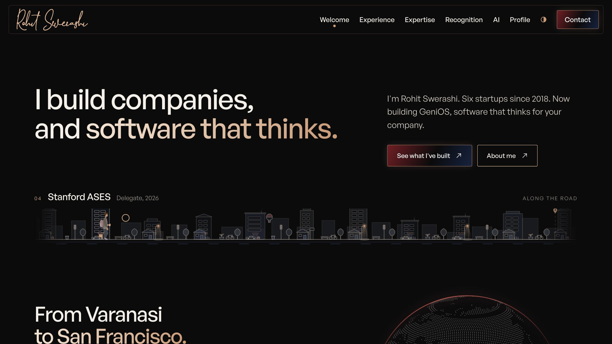
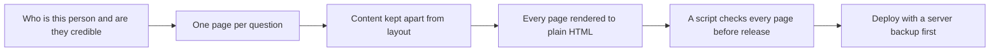
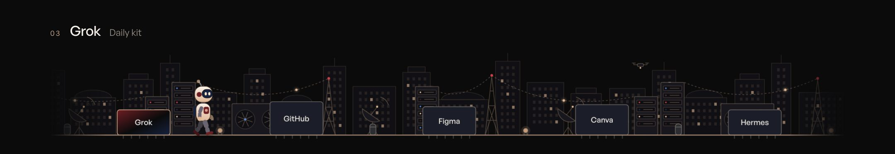
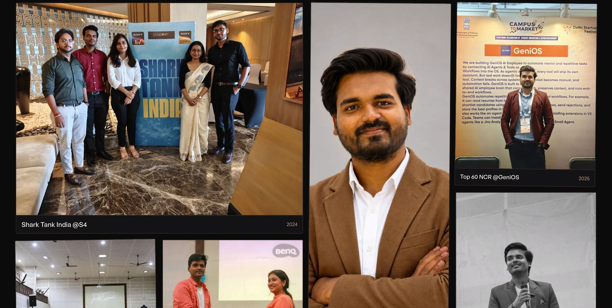
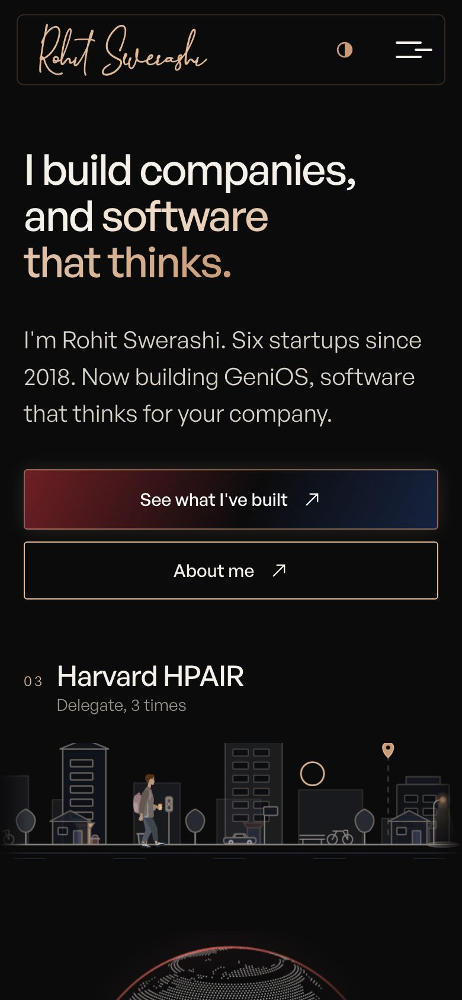
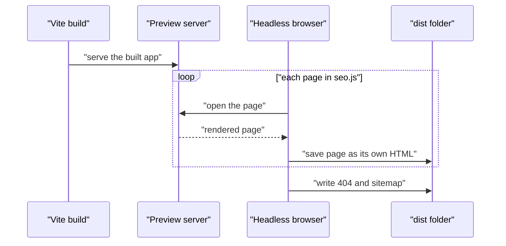

<!-- presentation:start -->
<p align="center"></p>

<p align="center">
  <a href="https://www.rohitswerashi.com"><strong>Visit www.rohitswerashi.com</strong></a>
</p>

<p align="center">
  <a href="https://www.rohitswerashi.com"></a>
</p>

This repository is the code of my current website, [www.rohitswerashi.com](https://www.rohitswerashi.com). It tells what I have built, what went wrong and what I learned, in pages a busy reader can scan. It replaces my earlier site. The site lives in the `rohit-swerashi/` folder and is live. If you only have a minute, read the site, not the code.

## The problem

A personal site has two readers. One is a person with two minutes: an investor, a hiring manager, someone deciding whether to reply to an email. The other is a search engine or an AI tool that has to understand who I am without running any scripts. Most portfolio sites serve the first reader with animation and fail the second, because the page is empty until JavaScript runs.

My earlier site was a book of 18 scroll chapters. It looked distinctive, but a visitor had to scroll through all of it to learn anything, and its text only appeared after scripts ran. This one starts from the question each reader brings.

## How I approached it

Decide what a visitor wants to know, give each question one page, and make sure every page works for a reader, a search engine and a phone.



**Key decisions**

| Decision | Why | Trade-off |
|---|---|---|
| Write every page out as its own HTML file after the build (`scripts/prerender.mjs`) | Search engines and AI tools get the text without running JavaScript | The build needs a headless browser and takes longer |
| Keep text in `src/content/`, apart from the screens | Changing a sentence does not touch layout code | 13 content files to keep consistent |
| A plain `facts` page and `llms.txt` | A short, factual page for crawlers and quick readers | Facts exist in more than one place and need upkeep |
| A browser script drives every route at three screen sizes (`qa/run.cjs`) | Catches overflow, broken images and house rules before a visitor does | Slow, and needs Playwright installed |
| Deploy script backs up the server before uploading (`scripts/deploy-hostinger.sh`) | A bad release can be undone | Tied to one host |
| Old addresses redirect in `public/.htaccess` | Links from the earlier site keep working | A growing list of rules |

## What I built

| Page | What is there |
|---|---|
| [Welcome](https://www.rohitswerashi.com/) | Who I am, the numbers, and the path through the places and programs along the way. |
| [Experience](https://www.rohitswerashi.com/experience) | GeniOS, Hustlers Fellowship, The Moronss, Homians, Mr. Elite and Smart ATS Builder. What shipped, and the story behind each. |
| [Expertise](https://www.rohitswerashi.com/expertise) | The problems I faced in product, design, sales, people and AI, and how I solved each one. |
| [Recognition](https://www.rohitswerashi.com/recognition) | Shark Tank India, Stanford ASES, Harvard HPAIR, Founders, Inc., NSRCEL IIM Bangalore and more, year by year. |
| [AI](https://www.rohitswerashi.com/ai) | How I built eight AI products, why memory is not the product, and how I see the autonomous company. |
| [Profile](https://www.rohitswerashi.com/about) | My beliefs, my timeline and a wall of moments from stages, classrooms and pitch rooms. |
| [Contact](https://www.rohitswerashi.com/contact) | Email, LinkedIn, X and YouTube, or book a 30 minute call. |

Behind these sit six case study pages under `/experience/`, a privacy page and a plain `/facts` page. In code, pages are in `src/pages/`, text in `src/content/` and shared parts in `src/components/`.

**A walk past the places.** A small figure walks along a street at the top of the Welcome page, past the places and programs along the way. At the bottom of every page, a robot walks through a tech city, past the tools I use every day.



**Moments, as they happened.** 33 photos, each tagged with the event and the year.



**Made for the phone too.** Every page has its own phone layout, in both dark and light themes.

<p align="center">
  
</p>

## How it works

1. The page text and facts are plain data in `src/content/`. Titles and descriptions for every page sit in `seo.js`.
2. `vite build` produces the React app.
3. `scripts/prerender.mjs` starts a local preview, opens each page in a headless browser and saves the rendered text as that page's own HTML file, with its title, description and structured data.
4. The same script writes a 404 page and a sitemap.
5. `qa/run.cjs` and `qa/seo.mjs` open the built site and fail the release on a broken rule.
6. `npm run deploy` builds, backs up the server folder, then uploads.



## What makes it different

<p align="center"></p>

| Question | A portfolio template | A link in a bio | This site |
|---|---|---|---|
| Does a search engine see the text? | Often only after scripts run | A short bio | Every page is saved as real HTML |
| Is there a page for AI tools? | No | No | `llms.txt` and a plain facts page |
| Who checks it before release? | Nobody | Nobody | A script, at laptop, wide and phone sizes |
| Phone layout | Shrunk desktop | Native | Checked at 390 pixels wide |
| Editing a sentence | Find it in markup | Edit the bio | Change one content file |

## By the numbers

<p align="center"></p>

Most of the code is styling, not logic. That is what a site with two themes and separate phone layouts looks like.

<p align="center"></p>

The Welcome page is the biggest because it carries the numbers, the street walk and the proof of work. The Recognition page is the smallest.

<p align="center"></p>

The wall of moments is 33 photos, and half of them come from 2022.

## What this shows

- The site is built around its readers. One page answers one question, and a plain facts page serves anyone who will not scroll.
- Text is data. 4,187 lines of content sit apart from the screens, so copy changes are safe.
- Release rules are executable. A script checks every page at three screen sizes for overflow, broken images, dashes and prices, instead of relying on a last look.
- Old links were not abandoned. The earlier addresses redirect to the new ones.

## What I would do next

- Remove `three` from `package.json`. It is listed as a dependency and nothing imports it.
- Split `src/styles/site.css` (13,442 lines) by page, so one page's styling can be read alone.
- Run the QA scripts in CI, not only on my machine.
- Add a short note in the repo on how the facts page is kept in step with the site.

## Tech stack

| Technology | What it does here |
|---|---|
| React 18, React Router 6 | Pages and routing |
| Vite 6 | Dev server and build |
| GSAP, Lenis | Scroll-driven motion and smooth scrolling |
| Playwright | Prerendering pages and the browser checks |
| Plain CSS | All styling, with dark and light themes |
| Apache `.htaccess` | Redirects and the 404 page |
| `rsync` over SSH | Deploy to the host, after a backup |

## Run it locally

```bash
cd rohit-swerashi
npm install
npm run dev        # http://127.0.0.1:5188
npm run build      # builds and writes one HTML file per page
npm run preview    # http://127.0.0.1:5189, serves the build
node qa/run.cjs    # drives every route in a browser
```

Built by [Rohit Swerashi](https://github.com/therohitji), Founder & CEO of [GeniOS](https://thegenios.com). [Book a call](https://cal.com/rohitswerashi/genios).

<!-- presentation:end -->
